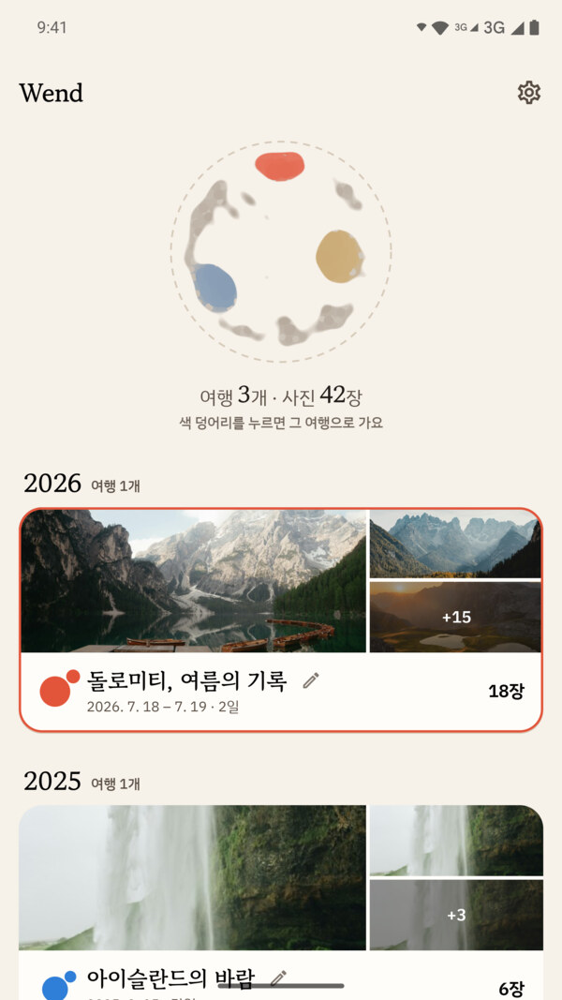
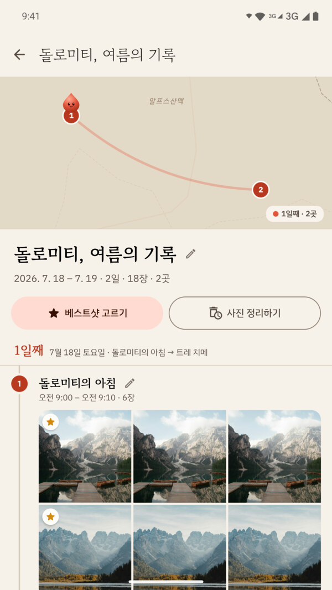
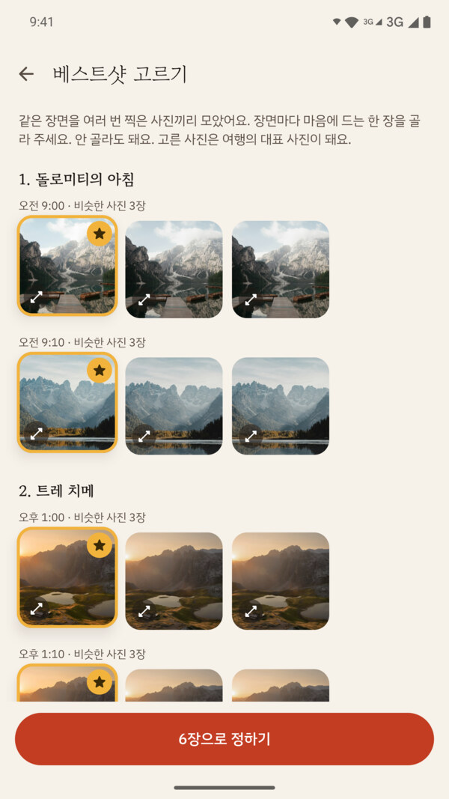
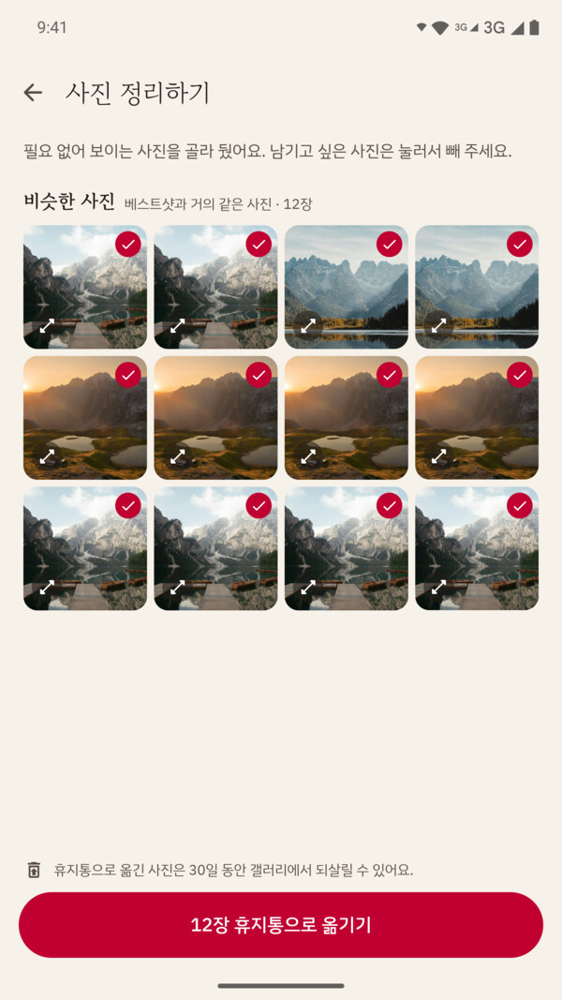

# Wend

[](https://github.com/jun-works/wend-android/actions/workflows/android-ci.yml)

휴대폰 사진에서 여행을 찾아 날짜와 장소별로 정리해 주는 Android 앱이에요.

**사진과 위치는 기기 밖으로 나가지 않아요.** 여행 찾기, 지명 붙이기, 지도, 베스트샷까지 모두 기기 안에서 처리해요.

<table>
  <tr>
    <td align="center"></td>
    <td align="center"></td>
    <td align="center"></td>
    <td align="center"></td>
  </tr>
  <tr>
    <td align="center">여행 목록</td>
    <td align="center">여행 상세</td>
    <td align="center">베스트샷 고르기</td>
    <td align="center">사진 정리하기</td>
  </tr>
</table>

## 주요 기능

- **여행 찾기**: 사진의 촬영 시각과 위치로 여행을 묶어요. 지명은 앱에 넣은 도시·자연 지명 데이터로 오프라인에서 붙여요.
- **여행 상세**: 날짜와 장소별로 사진을 나눠 보여주고, 오프라인 기본 지도에 이동 경로를 표시해요.
- **베스트샷 고르기**: 사진의 dHash와 밝기 값으로 같은 장면을 묶고, 묶음마다 남길 사진을 직접 골라요.
- **사진 정리하기**: 베스트샷과 거의 같은 사진을 골라 휴지통으로 옮겨요. 휴지통 사진은 30일 동안 되살릴 수 있어요.
- **빠진 사진**: 여행에 담기지 않은 사진을 날짜별로 모아 두고, 골라서 기존 여행에 넣거나 새 여행으로 만들어요.
- **다국어**: 한국어, 영어, 일본어, 중국어(간체·번체), 스페인어, 포르투갈어(브라질)

## 설계 결정

**온디바이스 지명과 지도.** 지명 찾기에 Android `Geocoder`나 지도 API를 쓰면 사진 좌표가 외부 서버로 나가요. 그래서 지명 데이터와 지도를 앱에 넣고 기기 안에서만 처리해요.

- **지명 데이터**: GeoNames의 인구 1천 이상 도시 171,228곳에 Wikidata의 한국어·일본어·중국어 이름을 붙이고, 틀린 이름은 직접 고쳤어요. "교토 시 → 교토"처럼 행정 단위 꼬리표도 정리했어요.
- **가까운 도시 찾기**: 위도·경도를 0.5° 칸으로 나눠 사진 위치 주변 칸만 검사해요. 날짜변경선 양쪽도 이어서 찾아요.
- **기본 지도**: Natural Earth 지도 데이터를 바이너리로 만들어 앱에 넣고, 산·호수 같은 자연 지명을 따로 얹어요.

## 기술 스택

| 구분 | 사용 기술 |
|---|---|
| 언어 · UI | Kotlin, Jetpack Compose(Material 3), Navigation Compose |
| 구조 · DI | MVVM, Hilt |
| 비동기 | Coroutines, Flow(StateFlow) |
| 데이터 | Room, DataStore, kotlinx.serialization |
| 백그라운드 | WorkManager |
| 이미지 | Coil, ExifInterface |
| 운영 | Firebase Crashlytics, Analytics |
| 대상 | minSdk 30 (Android 11), targetSdk 36 |

## 패키지 구조

```
app/src/main/java/app/wend/sea/
├── feature/   화면별 기능 (trips, trip, analysis, bestshot, left, viewer, globe, settings 등)
├── data/      사진 분석, 지명(geo), 로컬 저장소
├── core/      디자인 시스템, 문구
└── navigation/
```

## 테스트와 CI

푸시와 PR마다 GitHub Actions가 단위 테스트와 디버그 빌드를 실행해요([워크플로](.github/workflows/android-ci.yml)).

```bash
./gradlew testDebugUnitTest   # 단위 테스트
./gradlew assembleDebug       # 디버그 APK 빌드
```

## 스크린샷 사진 출처

스크린샷 속 사진은 [Unsplash 라이선스](https://unsplash.com/license) 사진이에요. 작가와 원문 링크는 [`tools/store-screenshots/assets/sources.json`](tools/store-screenshots/assets/sources.json)에 있어요.
